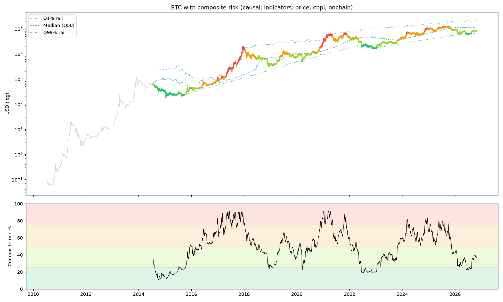
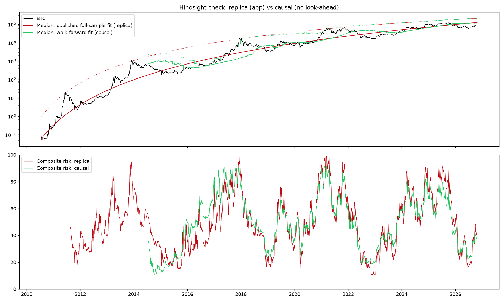

### Crypto SDCA System

#### Overview
The Crypto SDCA System is designed for long-term investing in cryptocurrencies, employing systematic dollar-cost averaging (SDCA) principles. It utilizes historical price data and statistical metrics to automate investment decisions based on predefined buy and sell thresholds.

#### Key Features
- **Relative deviation**: Measures how far price is from the 200-week SMA as a log ratio, `ln(price / SMA)`, so deviations in 2015 and 2025 are comparable (a dollar gap made recent years dominate).
- **No look-ahead Z-score**: Normalizes the deviation with an *expanding* mean and standard deviation, so each day's Z-score uses only data available on that day and past values never change when new data arrives.
- **Gradient Color Visualization**: Displays the price chart with a gradient color background based on the Z-score of the difference, facilitating visual trend analysis.


1. **200-week Moving Average**: Computes the 200-week (1,400-day) SMA to establish a baseline trend indicator.
2. **Z-score and Gradient Visualization**: Calculates `LogDev = ln(price / SMA)` and its Z-score `(LogDev - mean) / std`, where mean and std are expanding statistics over all days up to and including the current one (minimum one year of data). An expanding window was chosen over a rolling one because a 200-week cycle lasts ~4 years: a rolling window short enough to react would only hold one cycle and re-centre within it. This Z-score color-codes the price chart, highlighting periods of divergence from the long-term trend.
3. **Threshold-based Signals**: Identifies buying opportunities when the Z-score falls below the SDCA IN threshold (default **-1.0**), marked by blue diamonds (◆) below the price. It identifies selling opportunities when the Z-score rises above the SDCA OUT threshold (default **+1.5**), marked by red downward triangles (▼) above the price. Both thresholds are adjustable in the app.


#### Data
- **Yahoo Finance** `BTC-USD` daily closes (from 2014-09-17), downloaded live via `yfinance`.
- **Coin Metrics community data** (`PriceUSD`, https://github.com/coinmetrics/data, CC BY-NC 4.0) for 2010-07-18 to 2014-09-16, bundled in `data/btc_pre2014.csv`. Yahoo takes precedence wherever the two overlap; the prices agree to within 0.2% on the overlap day.
- With the extended history the 200-week SMA starts on **2014-05-17** (instead of mid-2018), and the Z-score from 2015-05-16, so the 2015, 2017, 2018/19, 2021 and 2022 cycles are all covered.

#### Default thresholds
With the log deviation and no-look-ahead Z the scale changed, so the defaults were recalibrated from -0.7 / +2.0 to **-1.0 / +1.5**. Historically this flags buys in mid/late 2015, Nov 2018 - Mar 2019, Mar - Apr 2020 and May 2022 - Oct 2023, and sells in May 2017 - Mar 2018 and Jan - Apr 2021. The 2024/25 peak sat much closer to the 200-week SMA in relative terms (about +150% at most, versus +1,500% in 2017), so it does not reach a sell signal at these defaults.

#### Sell signal method (selectable in the app)
Each cycle has peaked lower relative to the 200-week SMA: about 16x in 2017, about 6x in 2021 and about 2.5x in 2024/25. A Z-score measured against all history therefore never reached a sell level in 2024/25.
- **Cycle percentile (default):** sells when today's `ln(price / SMA)` is higher than a share (default **85%**) of the values from the last 1,460 days. That window is about one halving epoch (210,000 blocks, roughly 1,458 days). The rank is non-parametric, nothing is fitted, and it is causal. With the default it sells in 2017, early 2021 and Jul-Oct 2025 (first sell 2025-07-10, 88 days before the 2025-10-06 top), with no sells outside those periods. It works because it compares against the current cycle, so it means "the most stretched valuation in about 4 years". It is sensitive to the window: it stops firing in 2025 for windows over about 4.5 years.
- **Z-score (expanding):** the original sell rule, Z above the OUT threshold (default +1.5).

Buys always use the expanding Z-score. Three cycles are too few to validate any sell rule statistically, so treat the thresholds as judgement, not fitted truth.

#### Composite risk model (second, selectable model)
`composite.py` adds the model from the *Investing Campus BTC Strategic Dollar Cost Averaging Signal* web app
(https://sdca-signals-automation-production-bdd2.up.railway.app/) next to the 200-week SMA logic, which is unchanged.
In the Streamlit app pick **Model → Composite risk + Accum/Dist curve**. From the command line:
```bash
python composite_report.py                     # causal model, today's action, backtest, charts -> out/composite/
python composite_report.py --cash 5000 --start 2018-01-01 --capital 10000 \
    --indicators price,sharpe,cbpl,onchain --onchain-source site \
    --curve "10,10,10,10,5,0,0,0,0,0,0,0,0,0,0,0,0,-0.5,-2,-4,-10"
```
The web app is one static page that computes everything in the browser, so the formulas were read from its JavaScript:

* **Asymmetric Tail Curvature (price z).** Quantiles of log10(price) are a quadratic in log time:
  `Q_tau = c + a*x + b*x^2`, `x = ln(days since 2009-01-01) - 7.9914`. The curvature `b` is shared within
  (Q1, Q10, Q25), (Q50) and (Q75, Q95, Q99), and the 7 prices are sorted so the bands never cross.
  `z = +3` at Q1, `0` at Q50, `-3` at Q99, linear in log price, clipped to [-3, 3]. The Q1%/Q99% rails are Q1 and Q99.
* **Indicators.** Sharpe (realized P/L, 14d EMA), Cost-basis profit/loss ratio (7d EMA) and the Onchain risk composite
  (7d EMA) come from ChartInspect, and the app embeds them as precomputed z-scores (+ = cheap).
* **Composite.** It is the weighted mean of the enabled z's (default: price, CBPL and on-chain are on, Sharpe is off,
  each weight is 1). A day only counts if every enabled indicator has data. The result is clipped to [-3, 3], and
  `risk = 50 - 50*z/3`. The bands are 0-25 Buy, 25-50 Accumulate, 50-75 Trim and 75-100 Sell.
* **Curve.** It has 21 nodes at risk 0, 5, ..., 100 and is linear between them. The default is
  `10,10,10,10,5,0,...,0,-0.5,-2,-4,-10` from 0 to 100 risk. A positive value buys that % of the current cash that day;
  a negative value sells that % of the current BTC.
* **Backtest.** It is daily at the close with no fees. The default start is 2015-01-01 with $10,000. The benchmark is a
  lump sum on day 1, and max drawdown is measured peak to trough on the daily portfolio value.
* **Today's action.** The curve is read at the last day on which the full composite exists. A buy is
  `cash * rate / 100` USD.

**Look-ahead and the two modes.** The app uses the paper's published *full-sample* coefficients (fitted on 2010-2026)
on every past date, and it ranks Sharpe against its *full* history. Both use future data.
* `causal` (default) refits the quantile regression walk-forward (an expanding window, refitted every 30 days on weekly
  samples up to that day; the first fit needs 4 years of data, so it starts in mid-2014). It ranks Sharpe with an
  expanding percentile. Because a rank is monotone, this is exact even without the raw data. The on-chain composite is
  rebuilt from free Coin Metrics community data: MVRV, NUPL, MVRV-Z and Puell, each with an expanding percentile, then
  a 7d EMA and an expanding robust z. Only 4 of ChartInspect's 8 inputs are available for free.
  `--onchain-source site` uses the app's own on-chain series instead.
* `replica` reproduces the app exactly. On the app's own price data it matches the app's JavaScript to within 1e-9.

From 2015-01-01 with $10k, using the default curve and data to 2026-10-26, the published-coefficient replica turns $10k
into about $27M against $2.5M for the lump sum. The walk-forward version ends at about $1.9M with the Coin Metrics
on-chain proxy and about $3.4M with the app's on-chain series. Most of the app's backtest edge comes from fitting the
bands on the future. `out/composite/summary.json` breaks this down by component.

Data: the app's indicator series are downloaded at run time from its page into `data/cache/` (git-ignored and not
redistributed, since they are derived from ChartInspect). Coin Metrics community data is CC BY-NC 4.0.
The app's source has no licence notice.




#### Running
```bash
pip install -r requirements.txt
streamlit run SDCA_crypto.py
python composite_report.py   # composite risk model report -> out/composite/
pytest tests          # unit tests for sdca.py and composite.py
```

4. **Automated Insights**: Provides a systematic approach to cryptocurrency investing, automating decisions based on statistical analysis of price trends.

#### Benefits
- **Objective Decision Making**: Removes emotional bias by relying on statistical metrics and predefined thresholds for buying and selling.
- **Long-term Focus**: Targets long-term investment opportunities by leveraging SMA and Z-score analysis.
- **Visual Clarity**: Enhances decision-making with visual representations of price trends.

#### Disclaimer
This system is for informational purposes only and should not be considered financial advice. Investors should conduct their own research or consult with a financial advisor before making investment decisions.
